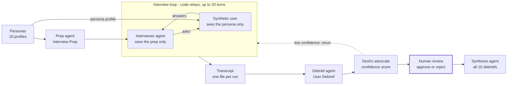

# Design Spec: Synthetic User Interview Agent Harness

Nov 21, 2026 · @Concepts & Beyond

A Python harness that runs synthetic jobs-to-be-done interviews with 10 audible-level personas, saves the transcripts, and fills in the Interview Prep and User Debrief templates. It is built to teach agent harness design one piece at a time.

## Overview

The harness runs one pipeline per persona: prep the interview, run it between two isolated agents, debrief it, challenge it, and send it to a person for approval. Once all 10 are approved, a synthesis agent compares them across segments.

**Goals**

- Run a full synthetic interview for each of the 10 customer segment personas, with 2 or 3 repeat runs each.
- Produce a filled Interview Prep and a filled User Debrief for every persona, matching the Concepts and Beyond templates.
- Keep every agent's context isolated so results can't leak between agents.
- Catch sycophantic users, leading questions and unsupported claims before a person reviews the output.
- Keep the code small and readable enough to teach in modules (target under 800 lines of Python).

**Non-goals**

- Validating demand. Synthetic interviews rehearse the guide and surface hypotheses. Real interviews (experiment D1) validate them.
- A general-purpose agent framework. The pipeline is linear on purpose.
- A web UI. Outputs are files a student can open and read.

**Who uses it**

- **Instructor:** runs the full pipeline as a demo and walks through each harness piece.
- **Students:** build the harness module by module, swap in their own product idea and personas, and compare results.

## Architecture

The pipeline runs left to right for each persona, then back along the bottom through review to synthesis.



Static version: [images/harness-pipeline.png](images/harness-pipeline.png)

The persona goes only to the synthetic user, never to the interviewer, and a low-confidence critique sends the interview back for one rerun.

## Agents

Six agent roles, each a system prompt plus a typed output. The persona is an input, so one definition serves all 10 segments.

| Agent | Input | Output | Default model | Template |
| --- | --- | --- | --- | --- |
| Prep agent | Persona summary (segment, job hypothesis), JTBD question bank | Prep JSON: key hypotheses, who to interview, starter questions | claude-sonnet-5-5 | Interview Prep |
| Interviewer agent | Prep JSON, transcript so far | Next question, or an end signal | claude-sonnet-5-5 | None |
| Synthetic user agent | Persona profile without the job hypothesis, this run's recent task, transcript so far | One in-character answer | claude-haiku-5-5 | None |
| Debrief agent | Transcript only | Debrief JSON: name, occupation, goals, pressing needs, insights, opportunities, with quotes | claude-sonnet-5-5 | User Debrief |
| Devil's advocate | Persona, transcript, debrief | Critique JSON: check results, unsupported claims, confidence rating | claude-opus-5-5 | None |
| Synthesis agent | All approved debriefs | Cross-segment report: shared jobs, strongest segment, claims to verify | claude-opus-5-5 | None |

The orchestrator is code, not an agent. It runs the loop, enforces isolation and writes files. Keeping it deterministic is a teaching point: only the parts that need judgment get a model.

Model choices are defaults in config. A cheaper model for the synthetic user keeps costs down across 30 runs. A stronger model for the devil's advocate makes it harder for the critic to be fooled by the agents it checks.

## Context isolation

Isolation is the most important rule in the harness. Each agent call is built from scratch by the orchestrator from only the artifacts allowed below. No agent shares a conversation history with another.

| Agent | Persona profile | Prep JSON | Transcript | Debrief | Critique |
| --- | --- | --- | --- | --- | --- |
| Prep agent | Summary only (segment, job hypothesis) | Writes it | No | No | No |
| Interviewer agent | No | Yes | Yes | No | No |
| Synthetic user agent | Yes | No | Yes | No | No |
| Debrief agent | No | No | Yes | Writes it | No |
| Devil's advocate | Yes | No | Yes | Yes | Writes it |
| Synthesis agent | No | No | No | Approved only | Yes |

**Why each rule exists**

- The interviewer never sees the persona, so it has to discover answers by probing instead of steering toward what it already knows.
- The synthetic user never sees the prep or the persona's job hypothesis, so it can't tailor answers to the hypotheses being tested.
- The debrief agent never sees the persona, so it reports what was said, not what the profile claims.
- The devil's advocate sees everything, because its job is to find gaps between the persona, the interview and the debrief.

**Enforcement:** a `build_context(agent, run)` function is the only way prompts get assembled. It reads an allow-list from config and raises an error if code tries to pass anything else. Students write a unit test that proves the interviewer prompt contains no persona text.

## Data contracts

Every agent output is JSON validated against a Pydantic model. An output that fails validation is retried once with the error message, then the run is marked failed.

**Persona** (`personas/<id>.json`, written by hand)

```json
{
  "id": "p01-visually-impaired-diyer",
  "segment": "Visually impaired DIYers",
  "job_hypothesis": "Finish a home task without depending on anyone",
  "name": "Marcus Reed",
  "age": 44,
  "location": "Columbus, Ohio",
  "behaviors": ["Uses a beeping phone app", "Asks a neighbor to check his work"],
  "values": ["Independence"],
  "current_alternatives": ["Phone level app", "Sighted neighbor"],
  "objections": ["Free app is good enough most of the time"],
  "recent_tasks": ["Mounted floating shelves in his home office about two weeks ago", "...", "..."]
}
```

**Interview Prep** (matches the Interview Prep template)

```json
{
  "persona_id": "p01-visually-impaired-diyer",
  "key_hypotheses": ["Dependence on sighted help is the top frustration"],
  "interviewee_profile": "Low-vision adult who does own home repairs",
  "starter_questions": ["Describe the last time you had to get something level"],
  "contrasting_questions": ["Was it worse to be crooked or to ask for help?"]
}
```

**Transcript** (`runs/<persona>/<run>/transcript.jsonl`, one line per turn)

```json
{"turn": 3, "speaker": "interviewer", "text": "Who told you it was level?", "tokens": 41, "ts": "2026-11-21T14:03:11Z"}
```

**User Debrief** (matches the User Debrief template)

```json
{
  "persona_id": "p01-visually-impaired-diyer",
  "run": 1,
  "name": "Marcus Reed",
  "occupation_role": "Warehouse supervisor, home DIYer",
  "about_me_and_goals": "...",
  "most_pressing_needs": [{"need": "...", "evidence_turns": [7, 9]}],
  "main_insights": [{"insight": "...", "evidence_turns": [12]}],
  "current_solutions": ["..."],
  "opportunities": ["..."]
}
```

The `evidence_turns` field is required. It forces the debrief agent to cite the transcript, and it gives the devil's advocate something concrete to check.

**Critique**

```json
{
  "persona_id": "p01-visually-impaired-diyer",
  "run": 2,
  "checks": {"evidence_trail": "pass", "too_agreeable": "fail", "missing_alternatives": "pass", "stereotype": "pass", "consistency": "warn", "reality_anchor": "warn", "job_strength": "pass"},
  "unsupported_claims": ["..."],
  "verify_in_real_interviews": ["..."],
  "confidence": "medium"
}
```

## Orchestration

The orchestrator is a plain Python loop. It relays messages between the interviewer and the synthetic user, applies stop rules, and runs the downstream agents in order.

**Turn-taking:** the interviewer speaks first. Each turn, the orchestrator builds a fresh prompt for the next speaker from its allowed context plus the transcript so far, calls the model, and appends the reply to the transcript file.

**Stop rules** (whichever comes first)

1. The interviewer returns `{"action": "end"}` after covering its starter and contrasting questions.
2. The interview reaches 20 interviewer turns (configurable).
3. The run hits its token budget (default 40,000 tokens per interview).
4. The synthetic user returns 3 answers in a row under 10 words, which signals a stalled interview.

**Repeat runs:** each persona runs 3 times. Each run gives the synthetic user a different task from the persona's `recent_tasks`, so the interviewer's "tell me about the last time" lands on a different real situation, the way it would with different real people. Temperature isn't used: current Claude models accept only the default. The devil's advocate compares runs for the consistency check.

**Rerun loop:** a critique with `confidence: low` triggers one automatic rerun of that interview. A second low rating goes to human review flagged, with no further reruns.

```python
def run_persona(persona, config):
    prep = call_agent("prep", build_context("prep", persona=persona.summary()))
    for run in range(config.runs_per_persona):
        transcript = Transcript(persona.id, run)
        while not stop_rule_hit(transcript, config):
            q = call_agent("interviewer", build_context("interviewer", prep=prep, transcript=transcript))
            if q.action == "end":
                break
            transcript.add("interviewer", q.text)
            a = call_agent("user", build_context("user", persona=persona, transcript=transcript))
            transcript.add("user", a.text)
        debrief = call_agent("debrief", build_context("debrief", transcript=transcript))
        critique = call_agent("advocate", build_context("advocate", persona=persona, transcript=transcript, debrief=debrief))
        save_run(persona.id, run, prep, transcript, debrief, critique)
    queue_for_review(persona.id)

for persona in load_personas("personas/"):
    run_persona(persona, config)
wait_for_approvals()
synthesize(load_approved_debriefs())
```

Personas run in parallel (one thread each) once students reach module 6. Earlier modules run them one at a time so the logs are easy to follow.

## Quality layer

Three layers check the output, from cheap and automatic to slow and human.

**1. Schema validation (code):** every output must parse into its Pydantic model, and every `evidence_turns` number must exist in the transcript.

**2. Devil's advocate (agent):** told to assume the persona is wrong until proven otherwise. It runs seven checks and rates each pass, warn or fail.

| Check | Question | Fail example |
| --- | --- | --- |
| Evidence trail | Does every debrief claim trace to a transcript turn? | "Values independence" with no supporting turn |
| Too agreeable | Did the user push back or name a reason not to buy? | User loves the idea by turn 3 |
| Missing alternatives | Did the user describe what they do today and why it falls short? | No current solution mentioned |
| Stereotype | Does the persona read as a cliché or pity story? | Blind user portrayed as helpless |
| Consistency | Do answers hold across repeat runs and within one run? | Weekly use in run 1, yearly in run 2 |
| Reality anchor | Does outside evidence (forums, research, advocacy data) support the behavior? | Pain point found nowhere outside the transcript |
| Job strength | What would the user do if the product never existed? | "I'd keep my app, it's fine" |

The reality-anchor check gets a web search tool. It's the only agent with a tool, which makes it a good lesson on when tools are worth the added risk.

A lighter interviewer check also runs: it flags leading questions ("Wouldn't it be great if...") and questions about the future instead of past behavior.

**3. Human review gate (person):** a command-line review step shows the debrief, the critique and links to the transcripts. The reviewer approves, rejects or edits. Only approved debriefs reach the synthesis agent.

**Limit to teach:** the devil's advocate shares the same model's blind spots. For segments 1 (visually impaired DIYers) and 10 (seniors), plan a review by 2 or 3 real people from those communities before treating any persona as credible.

## Project structure and configuration

Prompts, personas and config live in plain files so students can change behavior without touching code.

```
harness/
  config.yaml              # models, turn limits, budgets, isolation allow-list
  personas/                # 10 persona JSON files
  prompts/                 # one markdown system prompt per agent
    prep.md
    interviewer.md
    user.md
    debrief.md
    advocate.md
    synthesis.md
  harness/
    agents.py              # call_agent(): one function for every model call
    context.py             # build_context(): enforces isolation
    orchestrator.py        # run_persona() and the main loop
    schemas.py             # Pydantic models for every data contract
    transcript.py          # append-only JSONL writer
    review.py              # command-line human review gate
    render.py              # fills Interview Prep and User Debrief as Markdown
  runs/                    # outputs, one folder per persona and run
  tests/
    test_isolation.py
    test_schemas.py
    test_stop_rules.py
  module9_agent_sdk/       # the same harness rebuilt on the Claude Agent SDK
```

```yaml
# config.yaml
models:
  prep: claude-sonnet-5-5
  interviewer: claude-sonnet-5-5
  user: claude-haiku-5-5
  debrief: claude-sonnet-5-5
  advocate: claude-opus-5-5
  synthesis: claude-opus-5-5
interview:
  max_interviewer_turns: 20
  token_budget_per_interview: 40000
  runs_per_persona: 3
isolation:
  prep: [persona_summary, question_bank]
  interviewer: [prep, transcript]
  user: [persona_profile, recent_task, transcript]
  debrief: [transcript]
  advocate: [persona, transcript, debrief]
  synthesis: [approved_debriefs, critiques]
```

`render.py` turns each prep and debrief JSON into a document laid out like the Concepts and Beyond templates, so outputs can go straight into class materials.

## Observability, cost and guardrails

**Observability**

- Every model call is logged to `runs/<persona>/<run>/calls.jsonl` with agent name, model, input and output tokens, latency and the exact prompt sent. Students can replay any call.
- A run summary prints at the end: interviews completed, stop rule that ended each one, critique ratings, and total tokens.
- The exact-prompt log doubles as an isolation audit. Students search it for persona text in interviewer prompts.

**Cost controls**

- Token budget per interview (default 40,000) and a hard cap for the whole run in config.
- A `--dry-run` flag uses a stub model that returns canned answers, so students can test the plumbing for free.
- A `--personas p01,p05` flag runs a subset during development.
- Check current model pricing before class and set the run cap to match your budget.

**Guardrails**

- **Persona drift:** the user prompt restates the persona's name and core facts each turn, and the devil's advocate flags answers that break character.
- **Sycophancy:** the user prompt includes the persona's objections and current alternatives, and tells the agent to raise them when they fit.
- **Respectful portrayal:** the user prompt for disability and age segments tells the agent to portray competent adults with real constraints, not pity stories. The stereotype check backs this up.
- **Labeling:** every rendered output carries a "Synthetic interview, not real user data" banner, so nothing gets mistaken for research.

## Teaching plan

Nine modules. Modules 1 to 8 each add one harness piece to working code, built on the Anthropic Python SDK. Module 9 rebuilds the finished harness on the Claude Agent SDK for comparison. Every module ends with something students can run.

| Module | Harness piece | What students build | Exercise |
| --- | --- | --- | --- |
| 1 | A single agent call | `call_agent()` and the prep agent | Generate an Interview Prep for one persona and compare it with the template |
| 2 | Structured outputs | Pydantic schemas and retry on invalid JSON | Break the prompt on purpose and watch the retry fix it |
| 3 | Two agents talking | The turn-taking loop and transcript writer | Run one interview and read it aloud in class |
| 4 | Context isolation | `build_context()` and the allow-list | Leak the persona to the interviewer, rerun, and compare how leading the questions become |
| 5 | Stop rules and budgets | Turn limits, token budget and stall detection | Set the turn limit to 5, then 40, and discuss what changes |
| 6 | Pipelines and repeat runs | Debrief agent, 3 runs per persona, parallel personas | Compare 3 debriefs of the same persona and spot what varies |
| 7 | Evaluation | Devil's advocate, interviewer check, the one web search tool | Find one persona the critic rates low and explain why |
| 8 | Human in the loop | Review gate and synthesis agent | Approve or reject the 10 debriefs, then critique the synthesis report |
| 9 | Framework comparison | The same harness rebuilt on the Claude Agent SDK, in `module9_agent_sdk/` | Run both versions on one persona and list what the SDK hid, what it saved and where isolation got harder to prove |

Module 4 is the one I'd spend the most class time on. Showing students how much worse the interviews get when isolation breaks teaches the core idea of harness design better than any slide.

**Capstone:** students swap in their own product idea and 3 personas, run the full harness, and present what the synthetic interviews suggested and which claims they'd verify with real users first.

## Open questions

- [x] Raw Anthropic SDK or the Claude Agent SDK? **Decided: both.** Modules 1 to 8 use the raw Anthropic SDK so every moving part is visible. Module 9 rebuilds the harness on the Agent SDK, which is closer to what students would use at work.
- [ ] Should students write their own agent prompts in module 1, or start from provided ones and improve them?
- [x] Output format for rendered templates: Markdown only, or also PDF matching the Concepts and Beyond layout? **Decided: Markdown only.** PDF would add a rendering dependency the course doesn't need. Students can print the Markdown if they want paper.
- [ ] What's the per-student API budget, and does the class share one key or does each student bring their own?
- [ ] Should the synthesis agent rank segments, or only describe patterns and leave ranking to students?
- [ ] Who from the visually impaired and senior communities can review those two personas before class?
